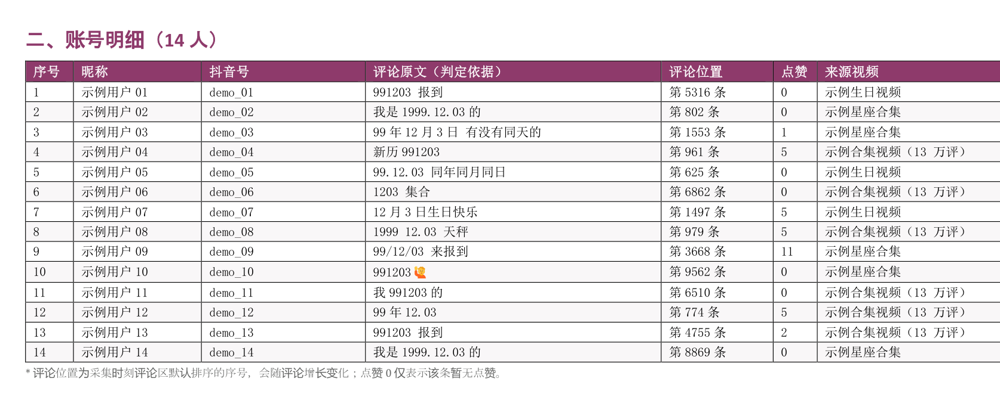
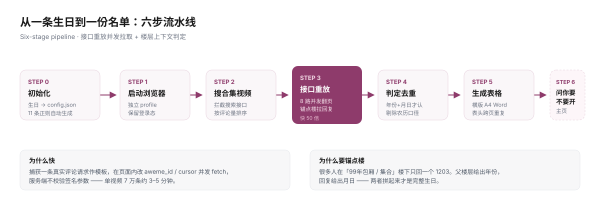

<div align="center">

# 🎂 douyin-birthday-hunter

**给一个生日，挖出抖音上同一天出生的人**

从十几万条评论里，把「1999.12.03」「991203」「99年包厢楼下回的那句 1203」全部捞出来，<br>
去重、剔除农历误报，最后给一份横版 A4 的账号名单。

[](LICENSE)
[](https://www.python.org)
[](https://nodejs.org)
[](https://github.com/yilaxi1013-dotcom/douyin-birthday-hunter/actions/workflows/validate.yml)
[](#贡献)
[](https://github.com/yilaxi1013-dotcom/douyin-birthday-hunter/stargazers)



<sub>↑ 实际输出（示例数据，非真实用户）· 横版 A4 · 表头跨页重复 · 序号与名单一一对应</sub>

</div>

---

## 这是什么

一个**抖音同生日账号采集**工作流，可作 [WorkBuddy](https://www.workbuddy.cn) Skill 使用，也能完全独立跑。

你只需要给一个日期：

```bash
python skill/scripts/init_task.py --date "1999-12-03" --out ./work
```

它就会：搜同生日合集视频 → 并发拉评论 → 连「包厢楼」里的回复一起挖 → 判定去重 → 出一份能直接用的 Word 表格 → **问你要不要把这些主页一次性打开**。

## 为什么不是「写个脚本滚评论区」

因为真正的难点不是抓，是这三件事：

| 难点 | 普通做法 | 这里的做法 |
|---|---|---|
| **量**：目标生日藏在十几万条评论里 | 模拟滚动，3000 条/小时，页面还容易崩 | 捕获真实请求作模板，页面内改 `cursor` 并发翻页，**7 万条 3–5 分钟** |
| **写法乱**：`991203` / `99.12.03` / 只回一个 `1203` | 正则匹不上就漏 | 识别「99年包厢 / 集合」**锚点楼**，用父楼层补年份 |
| **假阳性**：农历、学号、替朋友报的 | 一堆误判 | 只认「年份+月日」同时出现，农历口径单独剔除，长数字加边界 |

## 亮点

- ⚡ **快 50 倍**：不做滚动模拟，直接复用页面内的评论接口，8 路并发
- 🧠 **懂上下文**：能把「99年包厢」楼下裸回的 `1203` 正确归位到 1999-12-03
- 🧹 **判得干净**：11 条正则由日期自动生成，农历/长数字/区间写法都有对应处理
- 📄 **交付即用**：横版 A4 Word，列宽按内容分配，表头跨页重复，两表各自另起一页
- 🖥 **一键开主页**：同意后在一个窗口里按序号排好标签页，标题改成「01 昵称」
- 📦 **离线可用**：浏览器驱动随包提供，缺依赖时脚本自己去 npm / GitHub 取

## 快速开始

### 1. 环境自检

```bash
python skill/scripts/check_env.py
```

缺 Python 包会自动提示，加 `--fix` 直接装。缺浏览器驱动（`playwright-core`）时：

```bash
node skill/vendor/scripts/setup_deps.mjs
```

它会按 **随包自带 → npm 安装 → GitHub 克隆构建** 三级策略自动补齐，不用你判断。

### 2. 跑流程

```bash
# ① 生成配置（日期、关键词、全部正则）
python skill/scripts/init_task.py --date "1999-12-03" --out ./work

# ② 启动可调试浏览器（后台常驻，别关）
node skill/vendor/scripts/launch_browser.mjs --config ./work/config.json

# ③ 搜同生日合集视频
node skill/vendor/scripts/search_videos.mjs --config ./work/config.json

# ④ 拉评论 + 锚点楼回复
node skill/vendor/scripts/pull_comments.mjs --config ./work/config.json --top 12 --cap 40000

# ⑤ 判定去重
python skill/scripts/filter_accounts.py --config ./work/config.json

# ⑥ 出表
python skill/scripts/build_docx.py --config ./work/config.json --out ./生日名单.docx
```

### 3. 需要打开主页时

```bash
node skill/vendor/scripts/open_profiles.mjs --config ./work/config.json
```

**这一步永远要你先同意**——几十个标签页很吃内存，也属于会打扰你的操作。

## 工作流程



## 判定口径

| 评论写法 | 计入 | 说明 |
|---|:---:|---|
| `991203` / `19991203` | ✅ | 六位/八位连写，最高置信 |
| `99.12.03` / `99-12-03` / `99/12/03` | ✅ | 分隔符写法 |
| `99年12月3` / `1999年12月3日` | ✅ | 中文年月日 |
| `1999 12.03` / `12.03 1999` | ✅ | 年份与月日分离 |
| 锚点楼下裸回 `1203` / `12.3` | ✅ | 上下文推定，表格标注来源楼层 |
| 全局只有 `1203`，无年份 | ❌ | 存疑，单独统计 |
| 含「农历 / 阴历」 | ❌ | 农历与公历不同日 |

> 示例日期统一用 `1999-12-03`，不含任何真实用户数据。

## 输出长什么样

| 文件 | 内容 |
|---|---|
| `生日名单.docx` | 封面 → 结论摘要 → 账号明细表（7 列）→ 主页链接表 → 方法说明 → 免责声明 |
| `accounts.json` | 结构化名单，含 `sec_uid`、抖音号、命中依据 |
| `comments.jsonl` | 全量原始评论，便于复核 |
| `report.txt` | 命中分布、剔除原因统计 |

加 `--xlsx` 可同时导出 Excel。

## 常见问题

<details>
<summary><b>搜索页变成「验证码中间页」怎么办？</b></summary>

未登录或访问过频会触发。两个办法：在弹出来的浏览器窗口里手动完成验证/登录后重跑；
或跳过搜索，直接用已知视频链接：

```bash
node skill/vendor/scripts/pull_comments.mjs --config ./work/config.json \
  --videos "https://www.douyin.com/video/<id1>,https://www.douyin.com/video/<id2>"
```
</details>

<details>
<summary><b>页面返回 502 Bad Gateway</b></summary>

浏览器继承了系统代理。启动脚本默认已加 `--no-proxy-server`；如果所在网络确实需要代理，
改用 `--proxy http://host:port`。注意：清环境变量只管脚本自身，管不了 GUI 浏览器。
</details>

<details>
<summary><b>Edge/Chrome 开调试端口直接退出</b></summary>

136+ 版本拒绝了默认用户目录。本项目会复制 `Local State` + `Network/Cookies` 到独立 profile，
既满足「非默认目录」又保留登录态，不碰你日常用的浏览器。
</details>

<details>
<summary><b>拉到一定量就不返回了</b></summary>

平台限流。脚本内置 `blocked` 检测，触发即停该视频换下一个，不会死循环重试。隔段时间再补。
</details>

## 隐私与免责

- 只整理用户在**公开评论区主动发布**的信息，不做账号破解、不碰私信与非公开数据。
- 使用者须自行确保用途合法合规，遵守《网络安全法》《个人信息保护法》《数据安全法》及平台用户协议。
- **严禁**用于骚扰、跟踪、营销骚扰、诈骗、人肉搜索等侵害他人权益的行为。
- 作者仅提供技术方法，**不对使用者的使用行为及后果承担法律责任**。
- 结果属个人信息，请勿公开传播、转卖或共享；用完建议及时删除原始数据。

## 目录结构

```
douyin-birthday-hunter/
├── skill/
│   ├── SKILL.md                 # 完整流程与判定规则
│   ├── scripts/                 # init_task / filter_accounts / build_docx / check_env
│   ├── vendor/scripts/          # launch_browser / search_videos / pull_comments / open_profiles / setup_deps
│   └── references/              # 接口说明、正则设计、踩坑记录
├── docs/                        # 预览图、流程图、制作说明报告
├── examples/config.sample.json
└── .github/workflows/validate.yml
```

## English

**Douyin Birthday Hunter** — give it a birth date, and it digs out every Douyin user who publicly
posted the same birthday in comment sections.

It replays the comment API from inside the page (8-way concurrent paging), so a 70k-comment video
takes minutes instead of hours. It understands "anchor floors" like *"anyone born in '99?"* where
people only reply `1203` — the parent comment supplies the year. Output is a landscape A4 Word table
with dedup, lunar-calendar rejection, and per-row evidence.

Runs as a WorkBuddy skill or standalone. MIT licensed. Please use it lawfully and respectfully —
only public comments are touched, and the author takes no responsibility for misuse.

## 贡献

Issue / PR 都欢迎。特别想要：更强的写法覆盖、App 端折叠回复的补全、OCR 识别生日截图。

---

<div align="center">

**如果这个项目帮你省下了几个小时，点个 ⭐ 就是最好的支持。**

<sub>Made for people who are curious about the coincidence of birthdays.</sub>

</div>
